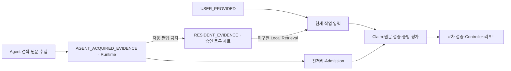

# 두 Evidence Pool과 파생 데이터

origin_category는 최초 취득 경위이며 storage_role은 현재 저장 역할이다. 이전 작업에서 받은 Agent 문서를 다음 작업이 로컬로 읽어도 최초 출처는 AGENT_ACQUIRED_EVIDENCE로 남는다. Cache/Runtime/Seed 역할 변경은 원문 출처와 독립적이다.

- `data/seed/`: 공개 권한과 초기 등록 승인이 확인된 자료만 허용. 이번 배포의 실제 문서 수는 0이다.
- `data/runtime/`: 사용자 입력·Agent 수집 원문·캐시·Claim·검증·실행 로그. 기본 Git 제외. `DC_VERIFY_DATA_DIR`로 위치를 바꾼다.
- `examples/synthetic/`: SYNTHETIC_TEST_DATA만 포함. 운영 증빙이나 공식 Seed가 아니다.
- `manifests/`: 기존 프로젝트의 상대 경로·해시·출처 메타데이터 조사 결과. 원문/인용/모델 응답/실제 Secret은 제외한다.

향후 데이터 저장 계약에는 document_id, SHA-256, source_url, origin_category, original_acquisition_run, storage_role, publication provenance, review as_of_date, analysis admission, verification/evidence state를 각각 보존해야 한다. Runtime에서 Seed로의 승인은 명시적이어야 한다. 이번 패키지는 현재 JSON 스키마를 유지하며 통합 Store API나 DB 스키마를 새로 구현하지 않는다.
